<div align="center">



<br><br>

[](https://bobbyos.dev/)

<br>

<sub>


</sub>


</div>

> Nineteen ninety-eight called. It does not want anything back. It is very happy in here.

**BobbyOS 98 SE** is my portfolio wearing a Windows 98 costume that it refuses to take off. It POSTs like a real machine, makes you log in to protect absolutely nothing, then drops you on a desktop where the windows drag, the clock judges your life choices, and Clippy has notes.

Open the thing called **My Projects** and you get a fake Internet Explorer pointed at `bob.web`. Behind that address bar is every real project I have shipped, each one rebuilt as the Geocities fan page it always deserved. The blink tags are load bearing. The typos are a design decision.

<div align="center">
<code>[ &nbsp;double-click any window below to open it&nbsp; ]</code>
</div>

<br>

<details>
<summary><b>&nbsp;<code>C:\</code>&nbsp; What is running on this machine&nbsp;</b></summary>

<br>

 dir /w \PROGRAMS">

| Program | What it actually is |
|---|---|
| **My Projects** | A fake Internet Explorer that only ever browses one website, mine |
| **Bobby-DOS Prompt** | A working terminal that takes commands and gives attitude |
| **Cat Viewer** | Summons a random cat off the internet. No reason. Just cat |
| **BobbyPaint** | MS Paint's distant cousin, raised on a CRT |
| **Notepad and Calculator** | The essentials, faithfully unremarkable |
| **Media Player** | A tiny playlist in period correct chrome |
| **Display Properties** | The wallpaper picker, the purest form of self expression |

**Games.** MS-DOS Games, a terminal "GTA Vice City" that is not GTA and will not be sued, Minesweeper, and 3D Pinball.

**Set dressing.** A BIOS boot sequence, a login screen for the vibes, the taskbar, a CRT overlay for that authentic eye strain, and a Firefox warning for the brave.

</details>

<details>
<summary><b>&nbsp;<code>C:\</code>&nbsp; The tech stack, or the lack of one&nbsp;</b></summary>

<br>

 type STACK.TXT">

No framework. No bundler. No `node_modules` the size of a small moon. Native ES Modules, one per window, with a stylesheet each. The only outside guest is `marked`, pulled from a CDN to turn the project pages' markdown into HTML inside the fake browser.

If it looks like it should not run without a build step, that is the trick. It never had one.

</details>

<details>
<summary><b>&nbsp;<code>C:\</code>&nbsp; Boot it on your own machine&nbsp;</b></summary>

<br>

 boot --help">

Native ES Modules will not load off the disk, because browsers block module imports over `file://`. Put any static server in front of it and the machine wakes up.

```bash
python3 -m http.server
# or
npx serve
```

Open the `localhost` address it prints and enjoy the ride.

</details>

<details>
<summary><b>&nbsp;<code>C:\</code>&nbsp; Directory map&nbsp;</b></summary>

<br>

 tree C:\ /f">

```text
C:\BOBBYOS
├── index.html            the desktop itself
├── src
│   ├── modules\          window manager, boot, taskbar, drag, Clippy
│   ├── programs\         Notepad, Calculator, Cat Viewer, Terminal, the browser
│   │   ├── games\        DOS Games, Vice City, Minesweeper, Pinball
│   │   └── internet_pages\   the Geocities-style page for each real project
│   └── styles\           one retro stylesheet per program
└── public\               icons, wallpapers, screenshots
```

</details>

<details>
<summary><b>&nbsp;<code>A:\</code>&nbsp; Do not open this one&nbsp;</b></summary>

<br>



You were warned. There was no key.

</details>

<div align="center">
<br>
<i>Best viewed at 800x600, with sound on.</i>
<br><br>
<code>© 1998-2026 Bob &nbsp;·&nbsp; the web as it should be</code>
</div>
