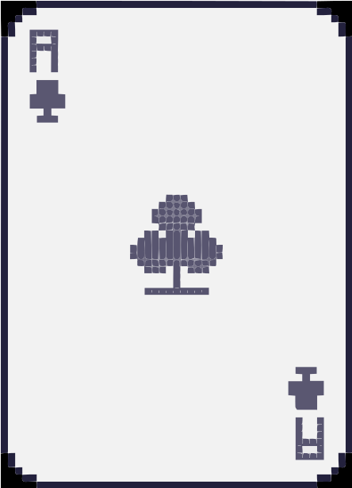

# ⚠ BobbyOS 98 SE ⚠

<p align="center">
  
</p>

# > **LIVE LINK:** >  [Click here](https://bobbyos.dev/)

<p align="center"><b>A fully operational, mildly cursed Windows 98 desktop — running entirely in your browser.</b></p>

<p align="center">
  
  
  
</p>

---

## ABOUT THIS CYBERSPACE

Welcome, traveler. You have reached **BobbyOS 98 SE**, a portfolio site built to look and feel like a Windows 98 machine that never got the memo the 2000s happened. No React, no build step, no framework holding your hand — just vanilla JavaScript, HTML and CSS, duct-taped together the way God and Bill Gates intended in 1998.

Somewhere inside this "OS" lives an Internet browser with a hand-written catalog of my actual projects, dressed up as long-lost Geocities pages. Yes, the visual glitches are on purpose. No, I will not fix the grammar.

---

## WHAT'S RUNNING ON THIS MACHINE

- **BIOS boot sequence** — a fake POST screen, because loading screens deserve drama.
- **Login screen** — for the illusion of security.
- **Desktop & taskbar** — draggable windows, a Start Menu, and a clock that judges you.
- **Clippy** — yes, he's back, and he has opinions.
- **CRT overlay** — for that authentic "my eyes hurt" effect.
- **Internet browser ("My Projects")** — a fake browser hosting a catalog of my real projects, styled like it's 1999.
- **Notepad, Calculator, BobbyPaint, Cat Viewer, Media Player** — the essential toolkit of any respectable desktop OS.
- **Games** — MS-DOS Games, "GTA Vice City" (a terminal game, not actually GTA — please don't sue), Minesweeper, and 3D Pinball.
- **Display Properties** — change the wallpaper, express yourself.

## TECH STACK

Vanilla JavaScript (ES Modules), HTML5, CSS3. No frameworks, no bundlers, no `node_modules` black hole. If it feels like it shouldn't work — it does, somehow.

## HOW TO SUMMON IT LOCALLY

This project loads native ES Modules (`<script type="module">`), so opening `index.html` straight from your file system won't work — browsers block module imports over the `file://` protocol. Serve it through any static server, for example:

```bash
python3 -m http.server
# or
npx serve
```

Then open the printed `localhost` address and enjoy the ride.

## PROJECT STRUCTURE

```
src/
├── modules/             # Window manager, boot sequence, taskbar, drag logic, etc.
├── programs/            # Individual "apps": Notepad, Calculator, Terminal, Games...
│   ├── games/           # DOS Games, Vice City, Minesweeper, Pinball
│   └── internet_pages/  # The fake webpages living inside the in-browser catalog
└── styles/              # One stylesheet per program, retro-themed

public/
├── icons/         # Desktop and Start Menu icons
├── wallpapers/    # Selectable wallpapers
└── screenshots/   # Assorted screenshots
```

<p align="center"><i>Best viewed at 800x600, with sound on.</i></p>
